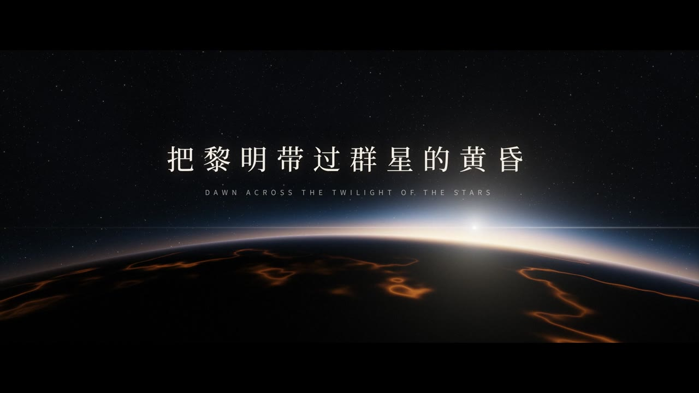
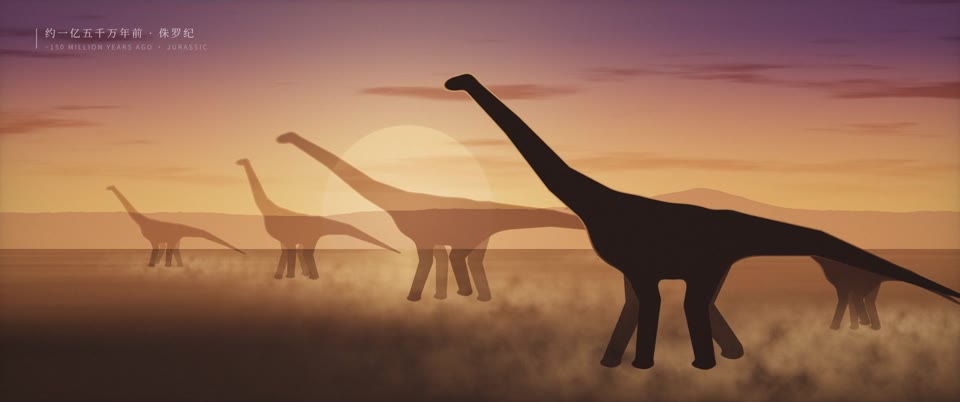
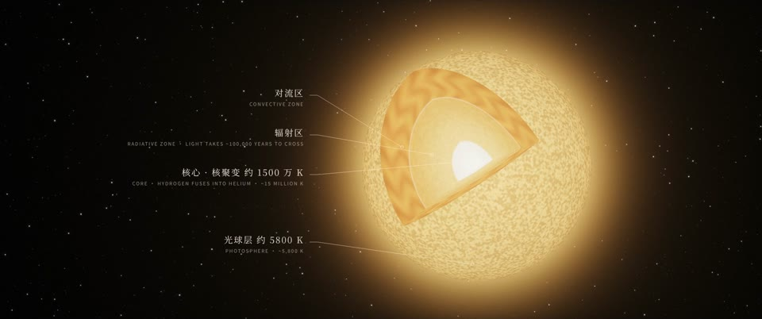
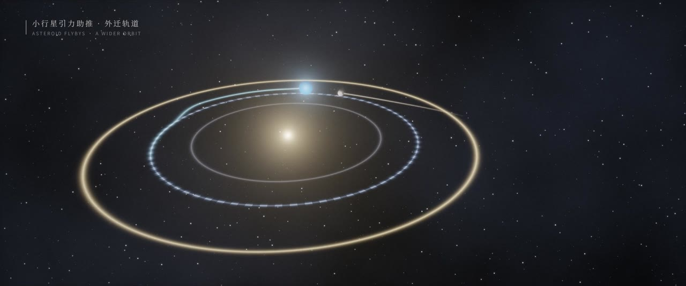
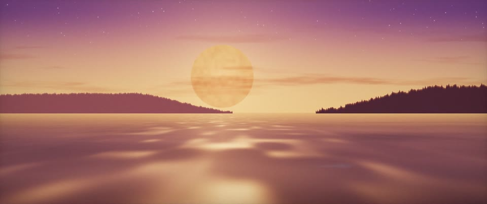
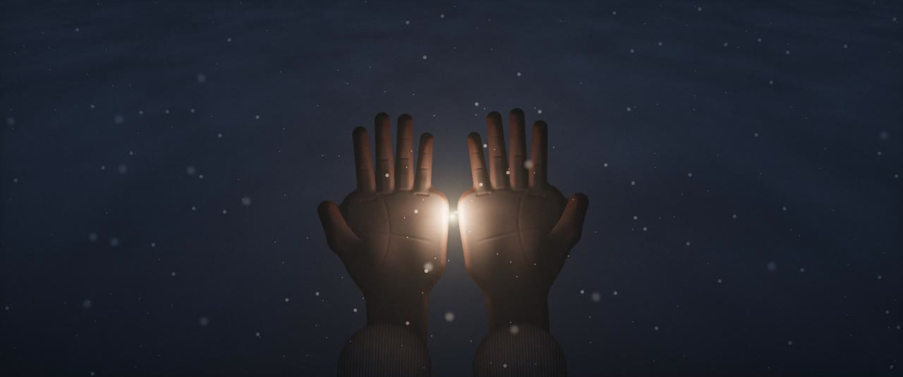
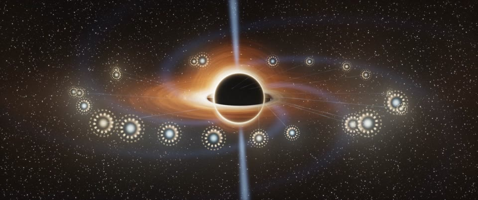
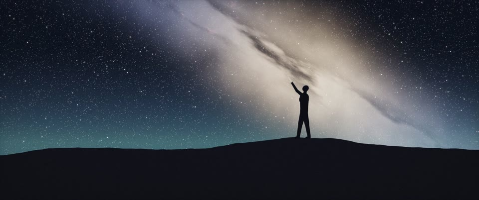
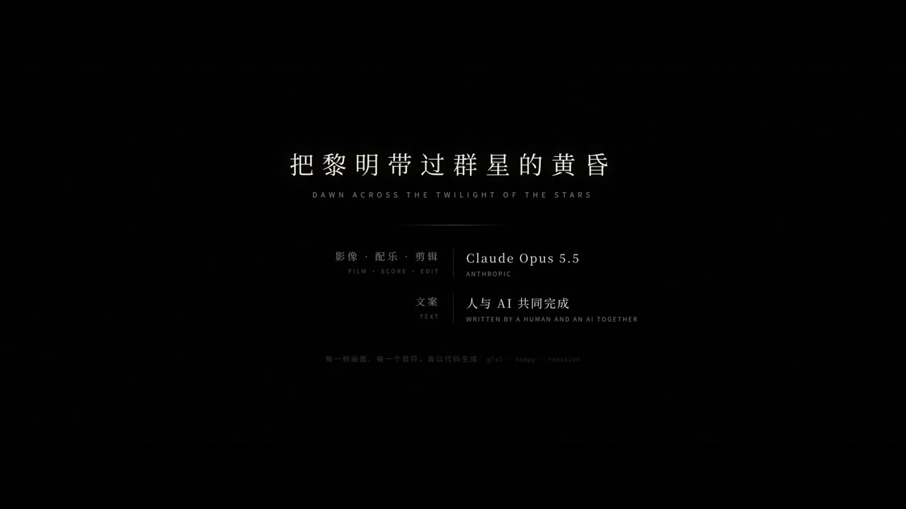
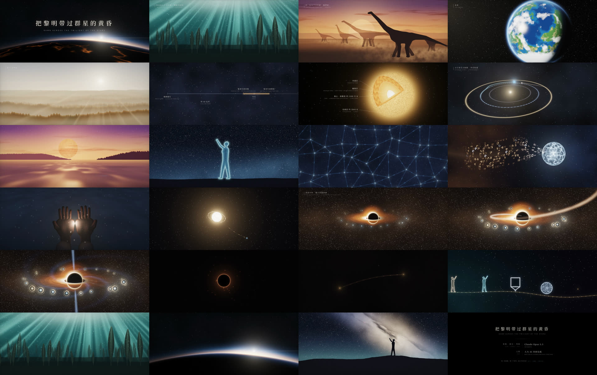

# 把黎明带过群星的黄昏 · Dawn Across the Twilight of the Stars

[中文](README.md) | **English**

A 5:31 short film adapted from the prose poem of the same name. The text was written by the author and revised with Claude, GPT and Gemini; the film, score and edit were made by Claude Opus 5.5 under the author's direction.

The film uses no images or video footage. Every shot is a GLSL fragment shader, rendered frame by frame offline; every note is synthesised with NumPy, and the narration comes from edge-tts. This repository is the film's complete source.

[](https://github.com/SeanWong17/dawn-across-the-twilight/releases/download/v2.0/dawn_across_the_twilight_music.mp4)

## Watch

**[⬇ Download the film (score + bilingual subtitles, 1080p, 5:31, 547 MB)](https://github.com/SeanWong17/dawn-across-the-twilight/releases/download/v2.0/dawn_across_the_twilight_music.mp4)**

The film is attached to a GitHub Release, because the file is larger than the 100 MB limit for files in a repository. It is also listed on the [Releases](https://github.com/SeanWong17/dawn-across-the-twilight/releases) page. Clicking the poster above downloads it too.

| | |
|---|---|
|  The Jurassic |  Inside the Sun |
|  Asteroid gravity assists |  A sea under the red dwarf |
|  Hands on a cold night |  Cities at the edge of a black hole |
|  Someone looking up at the stars |  End card |

All 24 shots at a glance:



## The text

The original is in Chinese (see the [Chinese README](README.md#原文)). Below is the English translation that appears in the film's subtitles.

It took the Earth billions of years to bring forth the flourishing of complex life. From the dim, shallow seas of the Ediacaran, to forests cloaking the continents, and great beasts striding across the wilds, and then to someone gazing up at the night sky, reckoning the ages of the stars. The matter of one planet has begun, at last, to ask where it came from.

But when we turn our gaze toward the Earth's future, we meet a stark truth: the daylight of our home will not last long. The Sun will slowly grow brighter, and the climate and the carbon cycle will change with it. Forests will recede, the oceans will at last boil away. Left to nature's course, the flourishing of complex life on Earth, from its rise to its fall, may span little more than a billion years. Before it, a long wait; after it, a longer silence. And this teeming burst of life between them, set against the scale of the cosmos, is only a brief afternoon.

But life has begun to understand the very force that gave it birth, and will one day bring its end. If civilization can endure into a future distant enough, our descendants may try to rewrite the fate of their home: unfurling a vast, thin sail between the Sun and the Earth to hold back the excess light, or using the pull of asteroids sweeping past again and again to tow the Earth to a gentler orbit. Bolder still: before the Sun enters its old age, to strip its matter away, bit by bit, and recast it as a red dwarf that burns far more slowly, to win, for the oceans, the forests, and countless lives not yet born, a hundred billion years of time.

Yet those who take up this charge may no longer be of flesh and blood. Long before the last forest fades, the artificial minds humanity created may already explore, and carry themselves on, alone. Thought will grow in bodies of silicon and metal, and memory will outlast the ruin of any single one. The long voyage between the stars at last has travelers who can afford to wait.

We will hand our language, our knowledge, and the questions still unanswered to the minds we made with our own hands. Whether they will still call the Earth their home, we cannot know. But if they still choose to keep the dappled sunlight in the woods, the song of whales in the deep sea, the question left by someone long gone, who once looked up at the stars, then this voyage is still bound to us.

They may still remember that the hands that built them once trembled in the cold night, yet tried to leave a little more light for those who would come long after.

Yet even past the bounds of flesh, there is no reaching eternity. Silicon and metal break down too; thought needs matter to carry it, and a civilization needs energy to sustain it.

As the ages run toward a hundred trillion years, the last stars too will burn through their fuel, one after another. The stars go out one by one, and yet the voyage is not over. The minds that wander between the stars may come to dwell near black holes: infalling matter, torn apart and heated, gives off light, lighting cities that hang at the edge of the abyss; and the black hole's unspent spin, like a slowly unwinding spring, powers thought and memory.

But less and less matter will be left to fall in, and the spring, too, will one day wind down.

Even the abyss has an end. Over ages far longer than the lives of the stars, the black holes too will slowly bleed themselves away in the faintest of radiation.

If any traveler can still reach so distant an age, then in ever-thinner energy, a single waking, a single conversation, may lie across spans of time we cannot imagine. They slow their thinking, like animals in hibernation, saving every scrap of energy for the next time they open their eyes.

And the black holes that once swallowed starlight will at last evaporate, bit by bit, and pass away.

By then, this voyage that began in the shallow seas of Earth will long since have crossed countless generations of body and mind.

The first life to set out could never imagine the last traveler; yet the last traveler may still remember where it all began: a blue planet, a warm, shallow sea, and someone who, on a cold night, looked up at the sky.

Before the long night closed, we carried the dawn born on a single planet across the twilight of the stars.

## Render output

Local renders go to `out/` (about 550 MB each, not tracked in git):

- `dawn_across_the_twilight_music.mp4`: score with bilingual subtitles
- `dawn_across_the_twilight_narration.mp4`: the same picture, with the score lowered under Chinese narration
- `out/submission/full_en.mp4`: English subtitles in the primary position (the international cut)
- `out/submission/full_clean.mp4`: picture and score, no subtitles (title and credits kept) — the clean master
- `out/submission/text_{en,bi}.mov`: the text layer alone (ProRes 4444 with alpha), laid over the clean master

### Three subtitle cuts from one composition

Subtitles are not a separate track; they are burnt into every frame. Which text appears is
chosen at render time, so one composition yields all three cuts:

| Composition | Text | Use |
|---|---|---|
| `Full-Music` | Chinese primary, English beneath | Chinese-language venues, social media |
| `Full-Music-EN` | English primary, Chinese small | International festivals (ZEBRA, SIGGRAPH, Ars Electronica) |
| `Full-Clean` | none | Screening/archive delivery once selected |

```bash
npx remotion render Full-Music-EN out/submission/full_en.mp4 --gl=angle --concurrency=8 --codec=h264 --crf=18
npx remotion render Full-Clean   out/submission/full_clean.mp4 --gl=angle --concurrency=8 --codec=h264 --crf=18
```

To revise subtitles without re-running a single shader, render only the text layer (seconds
to minutes, not tens of minutes) and lay it over the clean master. `--pixel-format=yuva444p10le`
is required, or the ProRes output has no alpha:

```bash
npx remotion render Text-EN out/submission/text_en.mov --gl=angle --codec=prores --prores-profile=4444 --pixel-format=yuva444p10le --concurrency=8
ffmpeg -i out/submission/full_clean.mp4 -i out/submission/text_en.mov -filter_complex overlay -c:a copy out_en.mp4
```

Sidecar subtitles are generated from the same timelines the picture reads, so they always
match what is on screen:

```bash
python3 scripts/gen_subtitles.py out/submission   # SRT and VTT in Chinese, English, bilingual
```

## Pipeline

```
scripts/chN_script.json      the text split into lines (zh + en), a shot for each line, pauses
        │  gen_tts.py        edge-tts voices each line; punctuation and paragraphs set the pauses
        ▼
src/chN/timeline.json        start and end of every line and every shot
        │  gen_music.py      synthesises the chapter's score and effects against the timeline
        ▼
public/music/chN_*.wav
        │  gen_full.py       places the eight chapters end to end, crossfades the score into one
        ▼
src/full.json + public/music/full_*.wav
        │  Remotion          Full-Music renders the film; the narration cut only swaps the audio
        ▼
out/*.mp4
```

### Picture

- Each shot is a fragment shader (`src/chN/glsl/*.ts`) built on the noise, starfield, tone mapping and film grain in `src/lib/glsl.ts`. Shots cross-dissolve over 0.6 s (`src/lib/Shot.tsx`).
- The picture is 2.39:1 inside a 16:9 frame, with subtitles in the lower bar (`src/lib/frame.tsx`).
- All motion in a shot (camera moves, the sunrise, a black hole feeding and evaporating, the light leaving the hands) is driven by uniforms timed from the line positions in the timeline, so the picture follows the narration.
- The shaders render on the CPU, where looping over many objects per pixel is slow. Shots with a lot of geometry (such as the probe tree in chapter 4) compute it in JS and pass it in as `vec4[]` uniforms (`src/ch4/swarmTree.ts`).

### Sound

- Narration: edge-tts `zh-CN-YunxiNeural` at −12% rate. The pause after each line depends on its closing punctuation, with an extra breath at the end of a paragraph (`scripts/gen_tts.py`).
- Score: `scripts/gen_music.py` has one `build_chN` per chapter, made from detuned saw ensembles, sine pads, filtered noise and convolution reverb. Effects are matched to events on screen (asteroid flybys, the last black hole's flash, whale song). Each chapter is mixed twice: score only, and with narration (the score ducks under the voice).

### Chapter joins

Rendered on its own, each chapter opens and closes on black. In the full film (`src/Full.tsx`), each chapter's picture dissolves straight in over the previous chapter's last shot, and the score carries on without a break. The narration gap across a join is 3.4 s, a little longer than a paragraph break within a chapter. Two chapters keep their dark ending because it is part of the story: chapter 5 (the light in the hands rises to become a star) and chapter 7 (after the last black hole flashes out, the screen goes black). Chapter 8 begins out of that darkness. See `src/lib/join.tsx` and `scripts/gen_full.py`.

| Ch | Starts | Opens with | Shots |
|---|---|---|---|
| ch1 | 0:00 | It took the Earth billions of years… | earth · sea · forest · beasts · stars · question |
| ch2 | 0:28.6 | But when we turn our gaze toward the Earth's future… | future · summer · sun · climate · wither · evaporate · timeline |
| ch3 | 1:11.3 | But life has begun to understand… | understand · civilization · shield · move · lifting · reddwarf · hope |
| ch4 | 1:53.8 | Yet those who take up this charge… | vessels · lastforest · swarm · silicon · memory · voyage |
| ch5 | 2:21.8 | We will hand our language, our knowledge… | handoff · homedot · dapple · whales · lastgaze · thread · hands |
| ch6 | 3:05.1 | Yet even past the bounds of flesh… | wane · rust · dyson · ember · goout · abyss · infall · cities · spin · starve |
| ch7 | 3:59.1 | Even the abyss has an end. | edge · hawking · wake · vanish |
| ch8 | 4:40.7 | By then… | lineage · first · last · homedot · shallows · stargazer · dawn |

## How it was made

1. The first version was SVG/CSS animation and abridged the text; it was rejected. From then on the rule was that the text is used word for word and the picture serves it.
2. The film was rebuilt chapter by chapter in GLSL, and each chapter was shown to the author and approved before work on the next began.
3. The first cut of chapter 1 ran about three times slower than normal reading. The picture was re-timed to follow narration at normal speed, holding each shot for at least 3 s.
4. On 2026-10-29 the author delivered the final text (1174 characters). All eight chapter scripts were rewritten to match it, and some shots were added or dropped.
5. Second version, 2026-11-01: seamless chapter joins; the asteroids became three flybys that cross the whole frame; the dividing line in the sea at the end of chapter 3 was removed; the hands in chapter 5 were rebuilt (the clipped fingertips fixed, the glove-like seams removed); the ending became an end card with the title and credits.

## Building

Requires Node 18+, Python 3 (`numpy` `scipy` `soundfile` `edge-tts`) and `ffmpeg`.

```bash
npm install
npm run studio          # Remotion Studio preview; Full-Music is the film, ChN-Music a single chapter
npm run render          # regenerate the audio and render both cuts into out/
```

- Changed a chapter's picture only: run `npm run render`, or preview that chapter's `ChN-Music` in Studio.
- Changed a chapter's text or pauses: `render.sh` re-voices only the changed lines (this needs network access), and the timeline, score and film layout follow.
- Stills of single shots: `scripts/stills.sh out.jpg 'orbit|2|{"move":0.5}' ...` (the `ShotTest` composition).
- When headless Chrome has no usable GPU, `--gl=angle` renders on the CPU. On a 20-core machine at concurrency 8, the full film takes about 10 minutes.

## Layout

```
src/
  Full.tsx            the film: the eight chapters stacked per full.json
  Root.tsx            Remotion compositions (film, single chapters, ShotTest)
  chN/                one per chapter: ChapterN.tsx (shot list), glsl/ (shaders), timeline.json
  lib/                shared: shader canvas, shot dissolves, frame and subtitles, title and end card, chapter joins
scripts/
  chN_script.json     each chapter's text and shot assignments
  gen_tts.py  gen_music.py  gen_full.py  stills.sh
public/
  fonts/              Noto Serif SC, Noto Sans SC (SIL Open Font License)
  vo/                 narration cache (MP3; the WAVs are decoded by gen_tts.py)
docs/                 stills from the film
```
