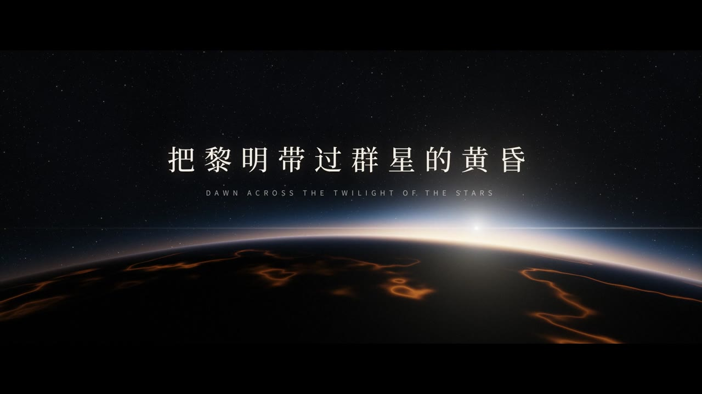
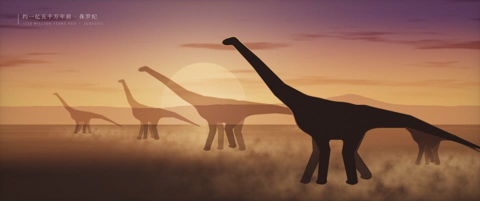
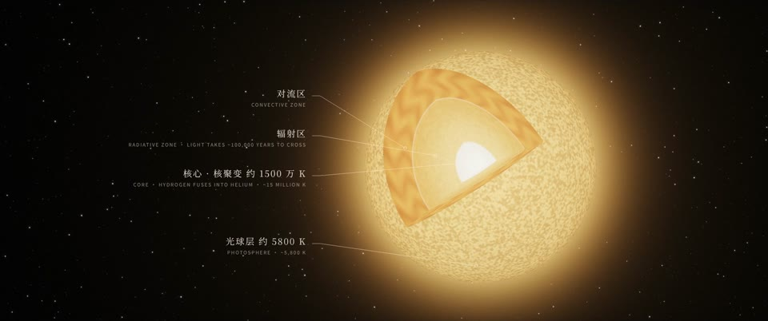
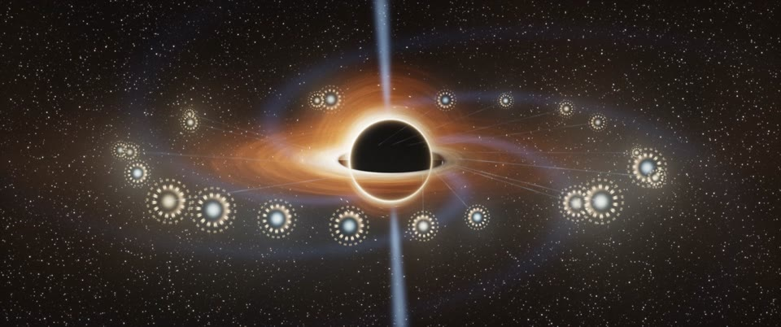

# 把黎明带过群星的黄昏 · Dawn Across the Twilight of the Stars

**中文** | [English](README.en.md)

一部 5 分 31 秒的短片，改编自同名散文诗。文案由作者主笔，Claude、GPT、Gemini 参与多轮修订；影像、配乐、剪辑由 Claude Opus 5.5 在作者导演下完成。

片中没有任何图片或视频素材：每一个镜头都是一段 GLSL 片元着色器，逐帧离线渲染；每一个音符都由 NumPy 合成，旁白由 edge-tts 生成。这个仓库就是这部片子的全部源码。

[](https://github.com/SeanWong17/dawn-across-the-twilight/releases/download/v2.0/dawn_across_the_twilight_music.mp4)

## 观看

**[⬇ 下载成片（配乐 + 双语字幕，1080p，5:31，547 MB）](https://github.com/SeanWong17/dawn-across-the-twilight/releases/download/v2.0/dawn_across_the_twilight_music.mp4)**

成片以 GitHub Release 附件的形式提供（单个文件超过了仓库 100 MB 的限制），也可以在 [Releases](https://github.com/SeanWong17/dawn-across-the-twilight/releases) 页面查看。点击上方海报同样可以下载。

| | |
|---|---|
|  侏罗纪 |  太阳内部 |
|  小行星引力助推 |  红矮星下的海 |
|  寒夜里的双手 |  黑洞边缘的城市 |
|  仰望星空的人 |  片尾 |

全片 24 个镜头一览：


## 原文

地球用了数十亿年，才迎来复杂生命的繁盛。从埃迪卡拉纪幽暗的浅海，到森林覆盖大陆、巨兽踏过荒原，再到有人仰望星空，计算群星的年龄。一颗行星上的物质，终于开始追问自己的来历。

可当我们把目光推向地球的未来，会看见一个冷峻的事实：故乡的白昼，并不漫长。太阳会逐渐变亮，气候与碳循环随之改变。森林将衰退，海洋终将蒸发。倘若任由自然演进，地球复杂生命从兴起到落幕的繁盛岁月，或许只有十几亿年。前面是漫长的等待，后面是更漫长的沉寂。中间这一场万物竞发，放在宇宙的尺度上，只是一个短暂的午后。

但生命已经开始理解，那使它诞生、也将使它消亡的力量。倘若文明能够延续到足够遥远的未来，我们的后代也许会尝试改写故乡的命运：在太阳与地球之间展开一面巨大的薄帆，挡住多余的阳光，或借小行星一次次掠过的引力，把地球牵引到更温和的轨道。更大胆的设想，是在太阳步入晚年之前，从它身上一点点剥离物质，把它重铸成一颗燃烧更缓慢的红矮星，为海洋、森林和无数尚未诞生的生命，争取千亿年的光阴。

而接过这项使命的，未必仍是血肉之躯。远在最后一片森林消逝之前，人类创造的人工智能，或许便已能够独立探索、延续自身。思想在硅与金属构成的躯体中生长，记忆跨越个体的损毁而保存。漫长的星际航行，终于有了等得起的旅人。

我们将把语言、知识，以及尚未得到回答的问题，交给亲手创造的心智。它们是否仍会把地球称作故乡，我们无从知晓。但倘若它们仍愿意保存林间斑驳的阳光，保存鲸群在深海中的歌唱，保存一个早已逝去的人望向星空时留下的疑问，那么，这场远征便仍与我们相连。

它们或许还会记得，建造自己的双手，也曾在寒夜里颤抖，却试图为遥远的后来者，多留下一点光。

只是，即使越过了血肉的边界，也到不了永恒。硅与金属同样会损坏，思想需要物质承载，文明需要能量维系。

当岁月走向百万亿年，最后的恒星也将陆续耗尽燃料。群星一盏盏熄灭，远征却仍未结束。那些在星际辗转的心智，也许会在黑洞附近栖居：坠落的物质被撕扯、加热，释放出光芒，照亮一座座悬在深渊边上的城市；黑洞尚未止息的自旋，像一根缓缓松开的发条，为思想与记忆供能。

然而，可供吸积的物质会越来越少，发条也终有松尽之时。

连深渊，也有尽头。在远比群星一生更漫长的岁月里，黑洞也将以极其微弱的辐射，缓缓流失自身。

倘若还有旅人能够走到那样遥远的年代，在日益稀薄的能量中，一次醒来、一场交谈，都可能隔着我们无法想象的岁月。它们放慢思考，像冬眠的动物那样，把每一点能量留给下一次睁眼。

而那些曾吞没星光的黑洞，也终将一点点蒸发，归于消逝。

到了那时，这场始于地球浅海的远征，早已跨越无数代形体与心智。

最初出发的生命，无法想象最后的旅人；最后的旅人，却仍可能记得出发的地方：一颗蓝色的行星，一片温暖的浅海，一个在寒夜里抬头望天的人。

在长夜合拢之前，我们曾把从一颗星球上诞生的黎明，带过了群星的黄昏。

## 成片文件

本地渲染结果在 `out/`（每个约 550 MB，不进 git）：

- `dawn_across_the_twilight_music.mp4`：配乐 + 双语字幕
- `dawn_across_the_twilight_narration.mp4`：同一画面，配乐压低，叠加中文旁白
- `out/submission/full_en.mp4`：英文主位字幕版（国际投递母版）
- `out/submission/full_clean.mp4`：清洁母版，画面与配乐，无字幕（标题与片尾署名保留）
- `out/submission/text_{en,bi}.mov`：文字层（ProRes 4444 带 alpha），叠在清洁母版上即得对应字幕版

### 三个字幕版本

字幕不是独立轨道，而是烧进每一帧的。所以片子的文字由 `--props` 决定，同一个合成可以出入三种文字：

| 合成 | 文字 | 用途 |
|---|---|---|
| `Full-Music` | 中文主位 + 英译 | 中文场、社交媒体 |
| `Full-Music-EN` | 英文主位 + 中文小字 | 国际影展（ZEBRA、SIGGRAPH、Ars Electronica） |
| `Full-Clean` | 无 | 入围后放映交付 |

```bash
npx remotion render Full-Music-EN out/submission/full_en.mp4 --gl=angle --concurrency=8 --codec=h264 --crf=18
npx remotion render Full-Clean   out/submission/full_clean.mp4 --gl=angle --concurrency=8 --codec=h264 --crf=18
```

改字幕却不想重跑着色器时，只渲染文字层（几百秒，不是几十分钟），再叠到清洁母版上。
注意 `--pixel-format=yuva444p10le` 必须显式给，否则 ProRes 输出没有 alpha：

```bash
npx remotion render Text-EN out/submission/text_en.mov --gl=angle --codec=prores --prores-profile=4444 --pixel-format=yuva444p10le --concurrency=8
ffmpeg -i out/submission/full_clean.mp4 -i out/submission/text_en.mov -filter_complex overlay -c:a copy out_en.mp4
```

字幕侧文件由时间轴直接生成，与画面上的文字同源：

```bash
python3 scripts/gen_subtitles.py out/submission   # 生成中/英/双语 SRT、VTT
```

## 管线

```
scripts/chN_script.json      原文逐句拆分（中英）、每句对应的镜头、停顿
        │  gen_tts.py        edge-tts 合成每句旁白，按句读与段落决定停顿
        ▼
src/chN/timeline.json        每句起止时间、每个镜头的起止
        │  gen_music.py      按时间轴合成该章配乐与音效，混出两版音轨
        ▼
public/music/chN_*.wav
        │  gen_full.py       计算八章首尾相接的位置，把配乐交叉淡化成一条
        ▼
src/full.json + public/music/full_*.wav
        │  Remotion          Full-Music 合成整片；旁白版只换音轨
        ▼
out/*.mp4
```

### 画面

- 每个镜头是一个片元着色器（`src/chN/glsl/*.ts`），共用 `src/lib/glsl.ts` 里的噪声、星空、色调映射与胶片颗粒。镜头之间 0.6 秒交叉溶解（`src/lib/Shot.tsx`）。
- 画幅 2.39:1，嵌在 16:9 里，字幕放在下方黑边（`src/lib/frame.tsx`）。
- 镜头里的运动（推拉、日出、黑洞的进食与蒸发、光离开双手）都由 uniform 驱动，时间点从 timeline 里的台词位置推出，所以画面总跟着旁白走。
- 着色器在 CPU 上渲染，逐像素遍历大量物体会很慢。需要很多几何体的镜头（例如第四章的探测器树）在 JS 里算好，再作为 `vec4[]` uniform 传入（`src/ch4/swarmTree.ts`）。

### 声音

- 旁白：edge-tts `zh-CN-YunxiNeural`，语速 −12%。每句后的停顿由句末标点决定，段落末尾多留一口气（`scripts/gen_tts.py`）。
- 配乐：`scripts/gen_music.py` 为每章写一个 `build_chN`，用锯齿波合奏、正弦垫音、滤波噪声和卷积混响合成；音效与画面事件对齐（小行星掠过、黑洞闪灭、鲸歌等）。每章混出纯配乐版和旁白版（配乐在说话时自动压低）。

### 章节衔接

单独渲染时，每章从黑场开始、在黑场结束。整片（`src/Full.tsx`）里，下一章的画面直接溶入上一章的最后一个镜头，配乐不断开；章节交界处的旁白间隔是 3.4 秒，略长于章内的段落停顿。第五章结尾（双手里的光升成一颗星）和第七章结尾（最后的黑洞闪灭后全黑）保留原有的暗场，因为那是叙事的一部分；第八章从这片黑暗里开始。机制见 `src/lib/join.tsx` 和 `scripts/gen_full.py`。

| 章 | 起点 | 开篇 | 镜头 |
|---|---|---|---|
| ch1 | 0:00 | 地球用了数十亿年… | earth · sea · forest · beasts · stars · question |
| ch2 | 0:28.6 | 可当我们把目光推向地球的未来… | future · summer · sun · climate · wither · evaporate · timeline |
| ch3 | 1:11.3 | 但生命已经开始理解… | understand · civilization · shield · move · lifting · reddwarf · hope |
| ch4 | 1:53.8 | 而接过这项使命的… | vessels · lastforest · swarm · silicon · memory · voyage |
| ch5 | 2:21.8 | 我们将把语言、知识… | handoff · homedot · dapple · whales · lastgaze · thread · hands |
| ch6 | 3:05.1 | 只是，即使越过了血肉的边界… | wane · rust · dyson · ember · goout · abyss · infall · cities · spin · starve |
| ch7 | 3:59.1 | 连深渊，也有尽头。 | edge · hawking · wake · vanish |
| ch8 | 4:40.7 | 到了那时… | lineage · first · last · homedot · shallows · stargazer · dawn |

## 制作过程

1. 第一版用 SVG/CSS 动画做成，删改了原文，被否掉。之后定下原则：原文一字不改，画面服从文字。
2. 改用 GLSL 逐章重做，每章做完先给作者看，通过后再做下一章。
3. 第一章初版节奏比正常朗读慢约 3 倍，改为画面跟随正常语速的旁白，每个镜头至少 3 秒。
4. 2026-10-29 作者交付定稿文本（1174 字），八章脚本全部按定稿重写，部分镜头随之增删。
5. 2026-11-01 第二版：章节无缝衔接；小行星改为三次完整穿过画面的引力助推；第三章结尾的海面去掉分界线；第五章的双手重新建模（修复指尖被裁掉，去掉像手套的接缝）；结尾改为片名加署名的片尾卡。

## 构建

需要 Node 18+、Python 3（`numpy` `scipy` `soundfile` `edge-tts`）和 `ffmpeg`。

```bash
npm install
npm run studio          # Remotion Studio 预览；Full-Music 是整片，ChN-Music 是单章
npm run render          # 从头生成音轨并渲染两版成片到 out/
```

- 只改了某一章的画面：直接 `npm run render`，或在 Studio 里看对应的 `ChN-Music`。
- 改了某章的文字或停顿：`render.sh` 会重新合成变动的句子（需要联网），时间轴、配乐和整片布局随之更新。
- 单个镜头的静帧：`scripts/stills.sh out.jpg 'orbit|2|{"move":0.5}' ...`（`ShotTest` 合成）。
- 无头 Chrome 拿不到可用的 GPU 时，用 `--gl=angle` 在 CPU 上渲染。在 20 核机器上 concurrency 8 渲染整片约 10 分钟。

## 目录

```
src/
  Full.tsx            整片：八章按 full.json 叠放
  Root.tsx            Remotion 合成列表（整片、单章、ShotTest）
  chN/                每章：ChapterN.tsx（镜头编排）、glsl/（着色器）、timeline.json
  lib/                共用：着色器画布、镜头溶解、画幅与字幕、片名与片尾卡、章节衔接
scripts/
  chN_script.json     每章原文与镜头分配
  gen_tts.py  gen_music.py  gen_full.py  stills.sh
public/
  fonts/              Noto Serif SC、Noto Sans SC（SIL Open Font License）
  vo/                 旁白缓存（MP3；WAV 由 gen_tts.py 解码生成）
docs/                 成片截图
```
