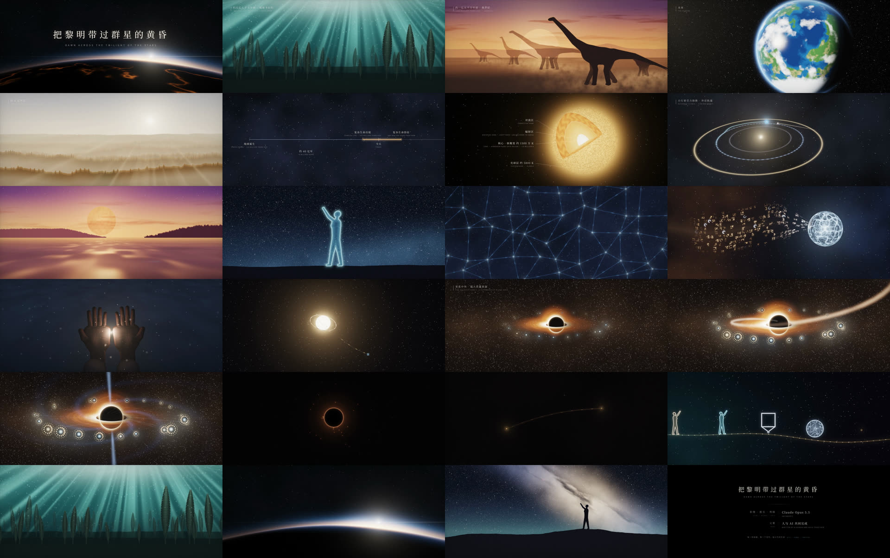
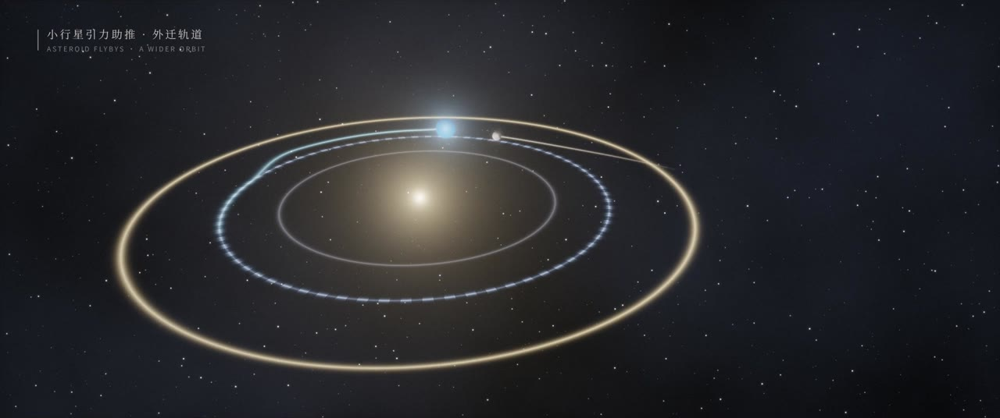
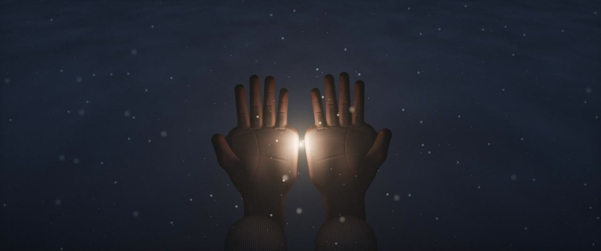
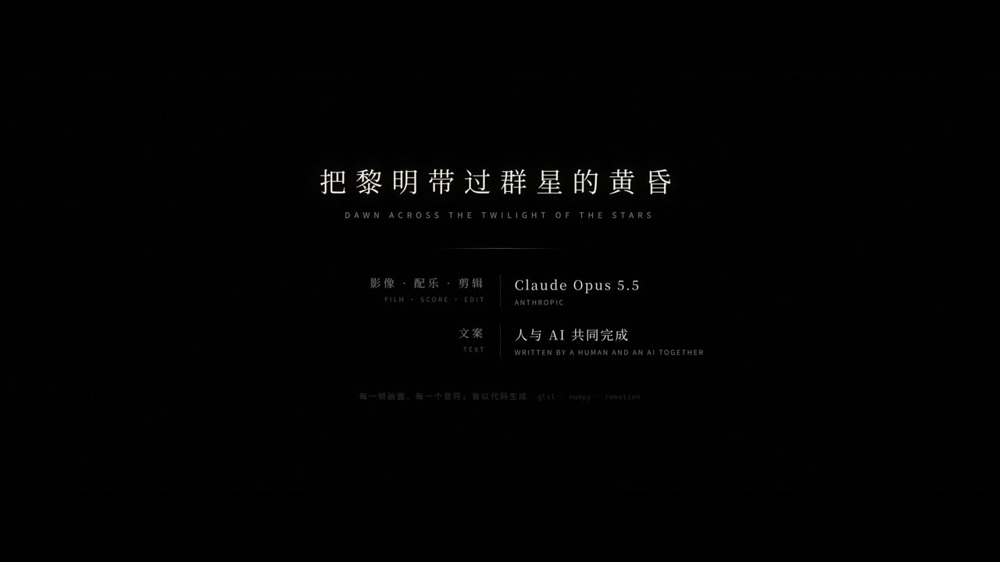

# 把黎明带过群星的黄昏 · Dawn Across the Twilight of the Stars

一部 5 分 31 秒的短片，改编自同名散文诗。影像、配乐、剪辑由 Claude Opus 5.5 完成，文案由人与 AI 共同完成。

片中没有任何图片或视频素材：每一个镜头都是一段实时运行的 GLSL 片元着色器，每一个音符都由 NumPy 合成，旁白由 edge-tts 生成。这个仓库就是这部片子的全部源码。



## 成片

渲染结果在 `out/`（每个约 550 MB，不进 git）：

- `dawn_across_the_twilight_music.mp4`：配乐 + 双语字幕
- `dawn_across_the_twilight_narration.mp4`：同一画面，配乐压低，叠加中文旁白

## 管线

```
scripts/chN_script.json      原文逐句拆分（中英）、每句对应的镜头、停顿
        │  gen_tts.py        edge-tts 合成每句旁白，按句读与段落决定停顿
        ▼
src/chN/timeline.json        每句起止时间、每个镜头的起止
        │  gen_music.py      按时间轴合成该章配乐与音效，混出两版音轨
        ▼
public/music/chN_*.wav
        │  gen_full.py       计算八章首尾相接的位置，把配乐交叉淡化成一条
        ▼
src/full.json + public/music/full_*.wav
        │  Remotion          Full-Music 合成整片；旁白版只换音轨
        ▼
out/*.mp4
```

### 画面

- 每个镜头是一个片元着色器（`src/chN/glsl/*.ts`），共用 `src/lib/glsl.ts` 里的噪声、星空、色调映射与胶片颗粒。镜头之间 0.6 秒交叉溶解（`src/lib/Shot.tsx`）。
- 画幅 2.39:1，嵌在 16:9 里，字幕放在下方黑边（`src/lib/frame.tsx`）。
- 镜头里的运动（推拉、日出、黑洞的进食与蒸发、光离开双手）都由 uniform 驱动，时间点从 timeline 里的台词位置推出，所以画面总跟着旁白走。
- 着色器在 CPU 上渲染，逐像素遍历大量物体会很慢。需要很多几何体的镜头（例如第四章的探测器树）在 JS 里算好，再作为 `vec4[]` uniform 传入（`src/ch4/swarmTree.ts`）。

### 声音

- 旁白：edge-tts `zh-CN-YunxiNeural`，语速 −12%。每句后的停顿由句末标点决定，段落末尾多留一口气（`scripts/gen_tts.py`）。
- 配乐：`scripts/gen_music.py` 为每章写一个 `build_chN`，用锯齿波合奏、正弦垫音、滤波噪声和卷积混响合成；音效与画面事件对齐（小行星掠过、黑洞闪灭、鲸歌等）。每章混出纯配乐版和旁白版（配乐在说话时自动压低）。

### 章节衔接

单独渲染时，每章从黑场开始、在黑场结束。整片（`src/Full.tsx`）里，下一章的画面直接溶入上一章的最后一个镜头，配乐不断开；章节交界处的旁白间隔是 3.4 秒，略长于章内的段落停顿。第五章结尾（双手里的光升成一颗星）和第七章结尾（最后的黑洞闪灭后全黑）保留原有的暗场，因为那是叙事的一部分；第八章从这片黑暗里开始。机制见 `src/lib/join.tsx` 和 `scripts/gen_full.py`。

| 章 | 起点 | 开篇 | 镜头 |
|---|---|---|---|
| ch1 | 0:00 | 地球用了数十亿年… | earth · sea · forest · beasts · stars · question |
| ch2 | 0:28.6 | 可当我们把目光推向地球的未来… | future · summer · sun · climate · wither · evaporate · timeline |
| ch3 | 1:11.3 | 但生命已经开始理解… | understand · civilization · shield · move · lifting · reddwarf · hope |
| ch4 | 1:53.8 | 而接过这项使命的… | vessels · lastforest · swarm · silicon · memory · voyage |
| ch5 | 2:21.8 | 我们将把语言、知识… | handoff · homedot · dapple · whales · lastgaze · thread · hands |
| ch6 | 3:05.1 | 只是，即使越过了血肉的边界… | wane · rust · dyson · ember · goout · abyss · infall · cities · spin · starve |
| ch7 | 3:59.1 | 连深渊，也有尽头。 | edge · hawking · wake · vanish |
| ch8 | 4:40.7 | 到了那时… | lineage · first · last · homedot · shallows · stargazer · dawn |

## 制作过程

1. 第一版用 SVG/CSS 动画做成，删改了原文，被否掉。之后定下原则：原文一字不改，画面服从文字。
2. 改用 GLSL 逐章重做，每章做完先给作者看，通过后再做下一章。
3. 第一章初版节奏比正常朗读慢约 3 倍，改为画面跟随正常语速的旁白，每个镜头至少 3 秒。
4. 2026-10-29 作者交付定稿文本（1174 字），八章脚本全部按定稿重写，部分镜头随之增删。
5. 2026-11-01 第二版：章节无缝衔接；小行星改为三次完整穿过画面的引力助推；第三章结尾的海面去掉分界线；第五章的双手重新建模（修复指尖被裁掉，去掉像手套的接缝）；结尾改为片名加署名的片尾卡。





## 构建

需要 Node 18+、Python 3（`numpy` `scipy` `soundfile` `edge-tts`）和 `ffmpeg`。

```bash
npm install
npm run studio          # Remotion Studio 预览；Full-Music 是整片，ChN-Music 是单章
npm run render          # 从头生成音轨并渲染两版成片到 out/
```

- 只改了某一章的画面：直接 `npm run render`，或在 Studio 里看对应的 `ChN-Music`。
- 改了某章的文字或停顿：`render.sh` 会重新合成变动的句子（需要联网），时间轴、配乐和整片布局随之更新。
- 单个镜头的静帧：`scripts/stills.sh out.jpg 'orbit|2|{"move":0.5}' ...`（`ShotTest` 合成）。
- 无头 Chrome 拿不到可用的 GPU 时，用 `--gl=angle` 在 CPU 上渲染。在 20 核机器上 concurrency 8 渲染整片约 10 分钟。

## 目录

```
src/
  Full.tsx            整片：八章按 full.json 叠放
  Root.tsx            Remotion 合成列表（整片、单章、ShotTest）
  chN/                每章：ChapterN.tsx（镜头编排）、glsl/（着色器）、timeline.json
  lib/                共用：着色器画布、镜头溶解、画幅与字幕、片名与片尾卡、章节衔接
scripts/
  chN_script.json     每章原文与镜头分配
  gen_tts.py  gen_music.py  gen_full.py  stills.sh
public/
  fonts/              Noto Serif SC、Noto Sans SC（SIL Open Font License）
  vo/                 旁白缓存（MP3；WAV 由 gen_tts.py 解码生成）
docs/                 成片截图
```
